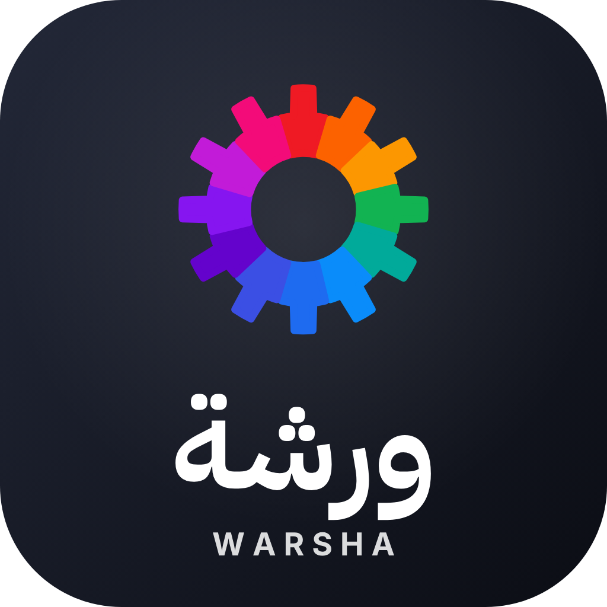

<div dir="rtl">

<p align="center"></p>

# ورشة WARSHA

**منصة عربية من ١٢ تطبيقاً إبداعياً ومكتبياً مفتوح المصدر، بواجهة عربية كاملة تدعم الكتابة من اليمين إلى اليسار، ومساعد ذكي داخل كل تطبيق.**

تصميم وتطوير: **محمد الشطي** — [malshatti.com](https://malshatti.com) — [info@malshatti.com](mailto:info@malshatti.com)

| التطبيق | الاسم اللاتيني | الاستخدام | المجلد |
|---|---|---|---|
| ريتوش | Retoush | تحرير الصور | `apps/retoush` |
| ريشة | Reesha | الرسم المتجهي | `apps/reesha` |
| مونتير | Monteer | مونتاج الفيديو | `apps/monteer` |
| طيف | Tayf | مكتبة الصور ومعالجة RAW | `apps/tayf` |
| وثيق | Watheeq | ملفات PDF | `apps/watheeq` |
| ومضة | Wamda | الرسوم المتحركة والمؤثرات | `apps/wamda` |
| نسق | Nasaq | تنسيق الصفحات والنشر | `apps/nasaq` |
| سطر | Satr | معالجة النصوص | `apps/satr` |
| منبر | Minbar | العروض التقديمية | `apps/minbar` |
| كشف | Kashf | الجداول الحسابية | `apps/kashf` |
| مخطط | Mukhattat | التصميم الهندسي CAD | `apps/mukhattat` |
| صدى | Sada | تحرير الصوت | `apps/sada` |
| **ورشة** | Warsha | منصة تثبيت التطبيقات وتحديثها | `apps/warsha` |

## التنزيل والتثبيت

### ويندوز 10/11 (64 بت)

من صفحة التطبيقات في موقعي: **[malshatti.com/apps](https://malshatti.com/apps/)**، أو من [إصدارات GitHub](https://github.com/malshatti44/warshaa/releases).

- **`Warsha-Suite-Setup-<الإصدار>-x64.exe`**: مثبّت واحد يضم كل التطبيقات، تختار منها ما تريد تثبيته.
- **`<الاسم>-Setup-<الإصدار>-x64.exe`**: مثبّت كل تطبيق على حدة (معالج تثبيت عربي، مع خيار الإنجليزية).
- **`<المعرّف>-<الإصدار>-windows-x64-portable.zip`**: نسخة محمولة بلا تثبيت (وهي ما تستخدمه منصة ورشة للتثبيت والتحديث).
- **`SHA256SUMS.txt`**: بصمات SHA-256 للتحقق من سلامة الملفات.

الملفات غير موقّعة رقمياً حالياً، لذلك قد يظهر تحذير SmartScreen عند أول تشغيل: اختر «مزيد من المعلومات» ثم «تشغيل على أي حال».
تحقق من البصمة في PowerShell:

```powershell
Get-FileHash .\Warsha-Suite-Setup-2.2.0-x64.exe -Algorithm SHA256
```

الواجهة بالعربية افتراضياً، ويمكن التحويل إلى الإنجليزية من إعدادات اللغة في كل تطبيق.

### ماك (macOS 11 أو أحدث، Apple silicon وIntel)

- **`Warsha-Suite-<الإصدار>-macos-universal.dmg`**: كل التطبيقات في ملف واحد؛ افتحه واسحب ما تريد إلى مجلد «التطبيقات».
- **`<المعرّف>-<الإصدار>-macos-universal.dmg`**: تطبيق واحد.
- **`SHA256SUMS-macos.txt`**: البصمات (`shasum -a 256 <الملف>`).

التطبيقات موقّعة توقيعاً محلياً (ad-hoc) وغير موثّقة من Apple بعد، فعند أول فتح قد يظهر أن ماك لا يستطيع التحقق منها:
اضغط «تم»، ثم افتح «إعدادات النظام ← الخصوصية والأمان» واضغط «فتح على أي حال».
تُبنى نسخة ماك على خوادم GitHub من [`.github/workflows/macos.yml`](.github/workflows/macos.yml).

**لينكس:** الشيفرة تُبنى عليه، لكن الحزم الجاهزة له لم تُنشر بعد.

## المساعد الذكي (الإصدار ٢٫٢)

في كل تطبيق زر «المساعد»: اطلب بالعربية ما تريد، فيقرأ المساعد المستند المفتوح وينفّذ الخطوات بأدوات التطبيق نفسه.

- يعمل بنموذج مفتوح المصدر على الجهاز ([Qwen3.5](https://huggingface.co/Qwen) بترخيص Apache-2.0 عبر [llama.cpp](https://github.com/ggml-org/llama.cpp))،
  يُنزَّل مرة واحدة عند أول استخدام إلى `%LOCALAPPDATA%\Warsha\assistant` وتشترك فيه التطبيقات كلها. ويمكن بدلاً منه استخدام مفتاح API لـClaude أو ChatGPT أو Gemini
  (يُحفظ مشفّراً لمستخدم ويندوز).
- الشيفرة في `shared/assistant`: حلقة الوكيل (`agent.rs`)، واجهة المحادثة (`ui.rs`)، وأدلة كل تطبيق (`knowledge/*.md`)، وقراءة النص العربي من الصور (`vision.rs`).
- **وثيق:** تعرّف على النص العربي في الصفحات الممسوحة بالنموذج المحلي، وتحويل PDF إلى Word يحفظ الفقرات واتجاه الكتابة.
- **سطر:** تدقيق إملائي عربي بقاموس آياسبل Ayaspell (محمد كبداني وطه زروقي، GPL-2.0 / LGPL-2.1 / MPL-1.1) في `shared/dictionaries`،
  محوّلاً لمحرك سطر بالأداة `tools/convert_ar_dict.py`.

## الربط بالذكاء الاصطناعي من الخارج (الإصدار ٢٫١)

يمكن لـ Claude Desktop وتطبيق ChatGPT لسطح المكتب (Codex) وGemini CLI أن تتحكم في تطبيقات ورشة مباشرة:
سجّل الدخول في تطبيق الذكاء الاصطناعي بحسابك، ثم افتح ورشة ◂ «الذكاء الاصطناعي» واضغط «ربط»، وأعد تشغيله.

- كل تطبيق يحمل خادم MCP خاصاً به (`<المعرّف>-cli.exe`) يعمل على نافذة التطبيق المفتوحة عبر قناة تحكم محلية.
- `warsha-mcp.exe` (بجانب منصة ورشة، المصدر في `apps/warsha/apps/warsha-mcp`) هو ما يشغّله تطبيق الذكاء الاصطناعي:
  يجيب عن قائمة الأدوات من ذاكرة مؤقتة، ويفتح نافذة التطبيق عند أول طلب، ثم يمرّر الرسائل في الاتجاهين.
- الربط يضيف مدخلاً لكل تطبيق مثبّت إلى `claude_desktop_config.json` أو `~/.codex/config.toml` أو `~/.gemini/settings.json`
  (مع نسخة احتياطية `.warsha-backup` قبل أول تعديل)، و«إلغاء الربط» يزيل هذه المدخلات وحدها.
- قنوات التحكم على `127.0.0.1` فقط، وترفض أي اتصال لا يبدأ بطلب JSON صالح (فلا تصلها طلبات المتصفح)،
  والتطبيقات تقرأ الملفات وتكتبها داخل مجلد المستخدم.

## ما الذي تغيّر عن المشروع الأصلي

- تعريب كامل لواجهات التطبيقات الاثني عشر والمنصة (أكثر من ٢١ ألف نص)، مع صيغ الجمع العربية الست.
- دعم ثنائي الاتجاه (Unicode Bidi) في محرك النصوص `shared/epaint` حتى تُقرأ الجمل العربية والمختلطة بترتيبها الصحيح، مع خط IBM Plex Sans Arabic.
- طبقة ترجمة في `shared/egui` لتطبيقَي منبر وصدى اللذين لم يكن لهما نظام ترجمة.
- أسماء البرامج والمجلدات والأيقونات وشعار «ورشة» الجديد (ترس من ١٢ قطعة بألوان التطبيقات، `icons/make_brand.py`) بدل علامات المشروع الأصلي التجارية، كما تشترط رخصة العلامة.
- المساعد الذكي، والتعرّف على النص العربي، والتدقيق الإملائي العربي (الإصدار ٢٫٢).

## البناء من المصدر

يتطلب Rust (MSVC) على ويندوز:

```bash
bash packaging/build_release.sh                                  # بناء التطبيقات وخوادم MCP ووسيط الربط
python packaging/package.py --version 2.2.0 --dist dist-2.2.0    # الحزم والمثبّتات (يتطلب Inno Setup 6)
```

كل تطبيق في `apps/<المعرّف>`، والمكتبات المعدّلة المشتركة في `shared/`، وأدوات الترجمة وذاكرتها في `i18n/`، والأدوات المساعدة في `tools/`.

## الترخيص والإسناد

ورشة مبنية على شيفرة مفتوحة المصدر مرخّصة بموجب **MIT أو Apache-2.0** حسب اختيارك. ملفات الترخيص
`LICENSE-MIT` و`LICENSE-APACHE` و`NOTICE` محفوظة في كل مجلد تحت `apps/` كما يشترط الترخيصان.

قاموس آياسبل العربي في `shared/dictionaries` بترخيصه الثلاثي GPL-2.0 / LGPL-2.1 / MPL-1.1 (انظر ملفات `ar_warsha-*` بجانبه)،
والنموذج المحلي Qwen3.5 بترخيص Apache-2.0 يُنزَّل من مصدره ولا يُضمَّن في هذا المستودع.

</div>

---

# Warsha (ورشة)

An Arabic suite of 12 open-source creative and office apps, fully localized with right-to-left text support and an AI
assistant inside every app.
Designed and developed by **Mohammed Al-Shatti** — [malshatti.com](https://malshatti.com) — info@malshatti.com

- **2.2:** an in-app assistant that drives each app's own tools, running an open-source model locally (Qwen3.5,
  Apache-2.0, via llama.cpp; downloaded once on first use) or a Claude / ChatGPT / Gemini API key — `shared/assistant`.
  Watheeq recognises Arabic text in scanned pages and converts PDF to Word keeping Arabic paragraphs and direction;
  Satr spell-checks Arabic with the Ayaspell dictionary (`shared/dictionaries`, GPL-2.0 / LGPL-2.1 / MPL-1.1).
- **2.1:** link the apps to Claude Desktop, the ChatGPT desktop app (Codex) and Gemini CLI through each app's MCP server.

Warsha builds on open-source code licensed under MIT OR Apache-2.0; each app's `LICENSE-MIT`, `LICENSE-APACHE` and
`NOTICE` are kept under `apps/<id>/`, as both licences require.

Downloads: **[malshatti.com/apps](https://malshatti.com/apps/)** or the
[GitHub releases](https://github.com/malshatti44/warshaa/releases). Windows x64: the suite installer, one installer per
app (Arabic wizard), portable zips. macOS 11+ (universal: Apple silicon and Intel): one .dmg per app and the suite .dmg,
built by `.github/workflows/macos.yml`. SHA-256 checksums for both. Builds are not code-signed with a vendor certificate
yet (the Mac apps are ad-hoc signed; on first open use System Settings › Privacy & Security › Open Anyway).
