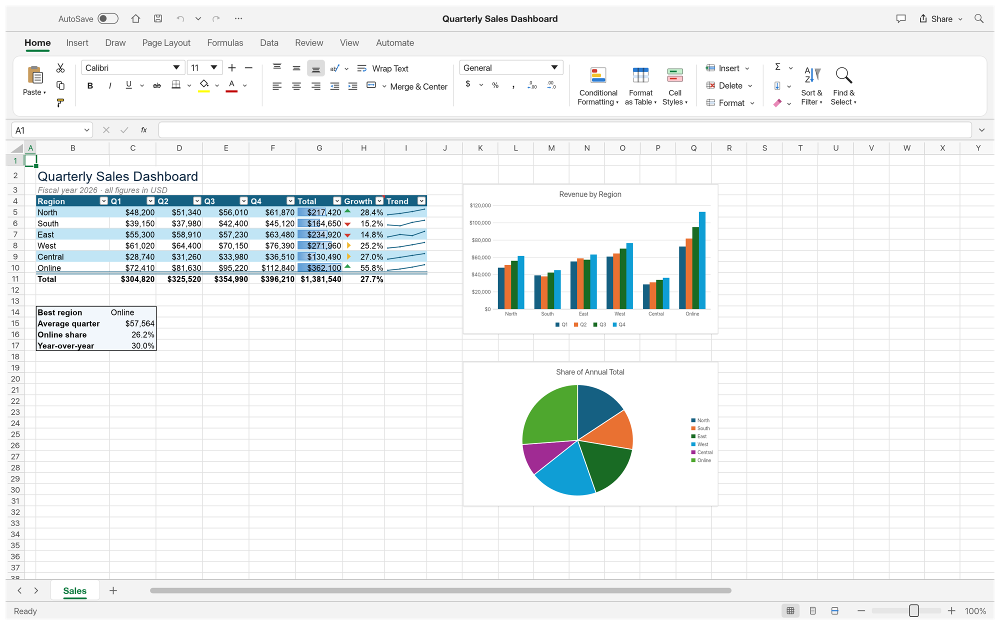
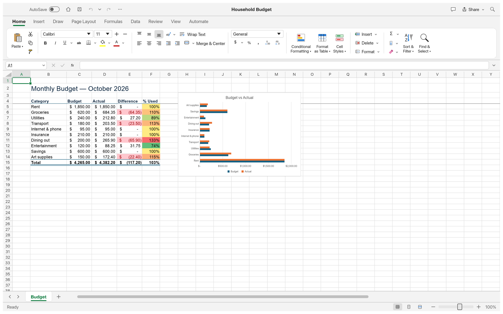
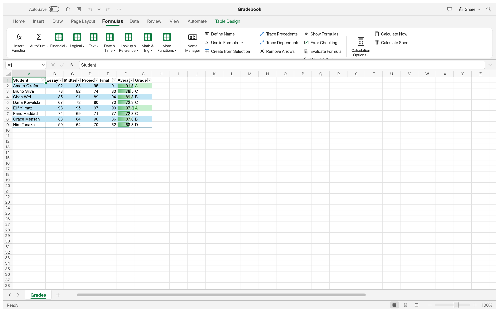
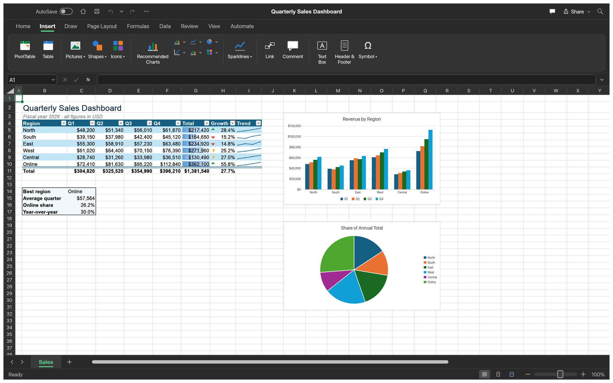
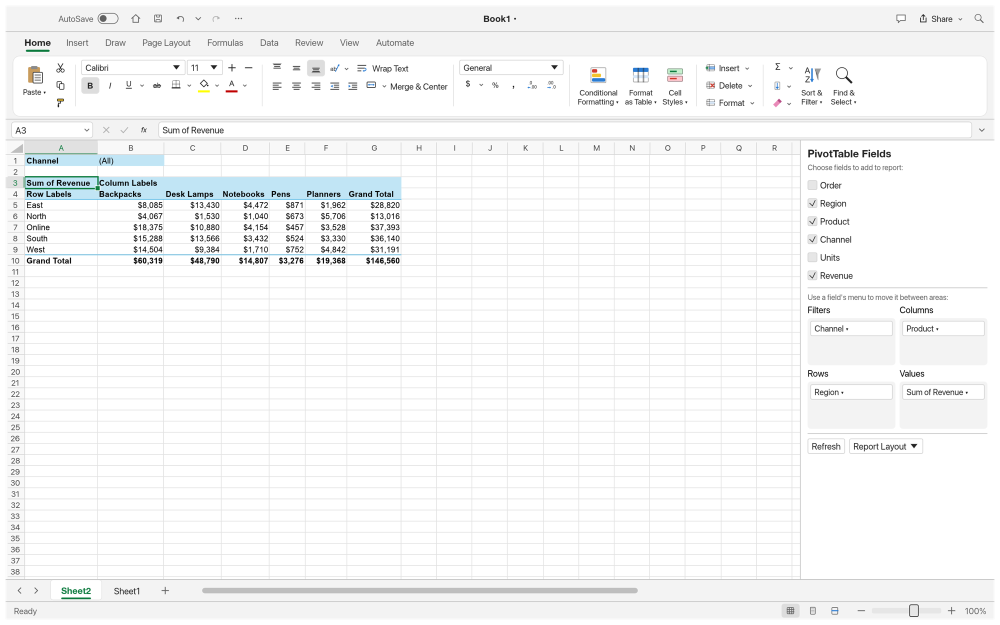
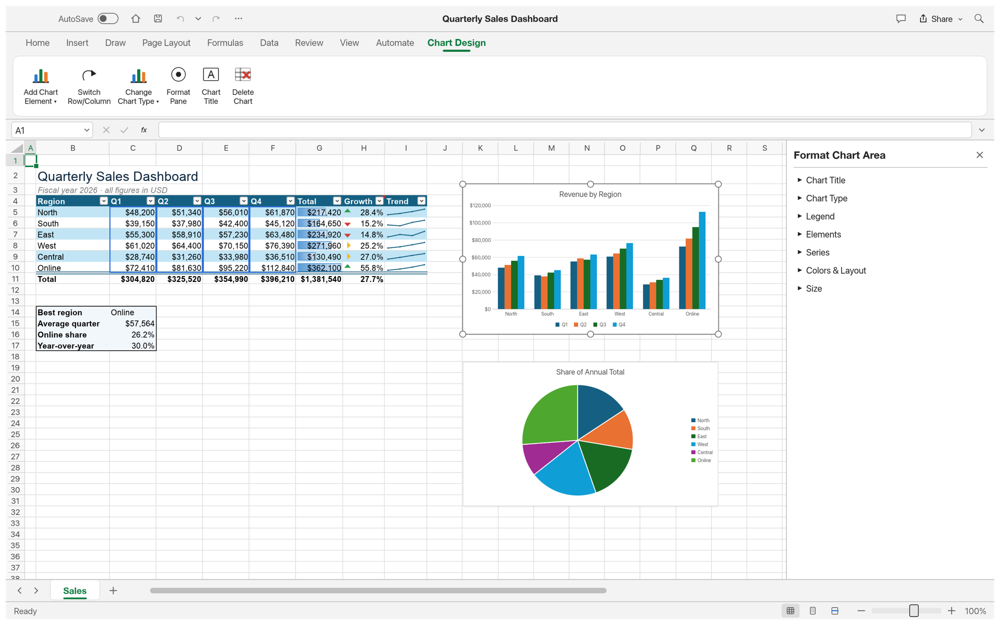
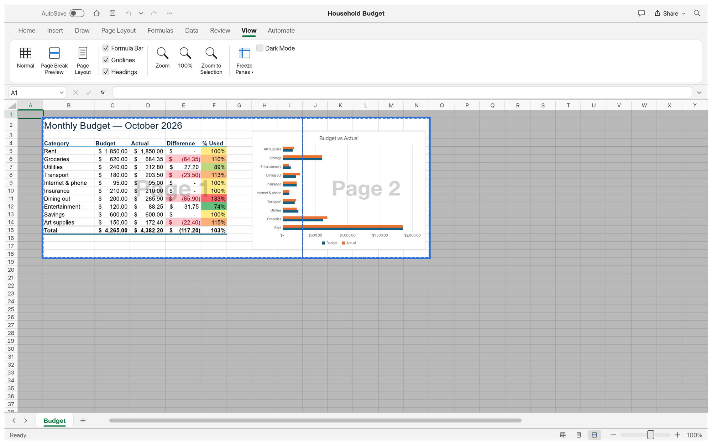

<p align="center">
  <a href="https://malshatti.com/apps/">
    <picture>
      <source media="(prefers-color-scheme: dark)" srcset="docs/brand/warsha-logo-white.svg">
      
    </picture>
  </a>
</p>

<h1 align="center">Kashf</h1>

<p align="center">
  <b>Spreadsheets and data; an open-source, clean-room reimplementation of Microsoft Excel, rebuilt in pure Rust.</b>
</p>

<p align="center">
  A fast, open-source, clean-room take on the Excel workflow. It runs natively on macOS,
  Windows, Linux and BSD, and in the browser via WebAssembly.<br>
  <i>By the Warsha team.</i>
</p>

<p align="center">
  
  
  
  
</p>

<p align="center">
  <a href="https://discord.gg/warsha"></a>
</p>

<p align="center">
  <a href="https://malshatti.com/apps/kashf.html"><b>Kashf on malshatti.com</b></a> ·
  <a href="https://malshatti.com/apps/">Warsha</a> ·
  <a href="https://malshatti.com/apps/">All Warsha apps</a>
</p>

<br>

<p align="center">
  
  <br><sub><b>Quarterly Sales Dashboard</b>: a table with a totals row, conditional formatting, sparklines and two live charts — built entirely from Kashf commands (<code>File → New → Sample</code>).</sub>
</p>

> [!NOTE]
> **Warsha is a community of artists from all walks of life.** Painters, photographers,
> filmmakers, illustrators, designers, animators, hobbyists, and people who picked up a pencil
> last week. If you make things, you're one of us. **[Come say hi on Discord](https://discord.gg/warsha).**

<p align="center">
  <a href="#a-look-around">A look around</a> ·
  <a href="#why-kashf">Why Kashf</a> ·
  <a href="#quick-start">Quick start</a> ·
  <a href="#for-agents-mcp-cli-and-the-control-channel">For agents</a> ·
  <a href="#architecture">Architecture</a> ·
  <a href="#roadmap">Roadmap</a> ·
  <a href="#the-warsha-apps">The Warsha apps</a> ·
  <a href="#license-and-credits">License and credits</a>
</p>

## A look around

<table>
<tr>
<td width="50%" valign="top"><p align="center"><sub><b>Formatting.</b> Accounting formats, cell styles, conditional rules and colour scales, frozen headers and a bar chart.</sub></p></td>
<td width="50%" valign="top"><p align="center"><sub><b>Formulas.</b> 500+ functions, dynamic arrays, LET and LAMBDA, structured table references.</sub></p></td>
</tr>
<tr>
<td width="50%" valign="top"><p align="center"><sub><b>Dark mode</b> and the Insert tab: tables, charts, sparklines, pictures, shapes, links and comments.</sub></p></td>
<td width="50%" valign="top"><p align="center"><sub><b>PivotTables.</b> Field list, filters, layouts, date grouping and show-values-as, saved to and read from XLSX.</sub></p></td>
</tr>
<tr>
<td width="50%" valign="top"><p align="center"><sub><b>Charts.</b> Seventeen chart types, Chart Design tab and a Format pane; selecting a chart outlines its source data.</sub></p></td>
<td width="50%" valign="top"><p align="center"><sub><b>Page Break Preview</b>, print settings, and PDF export and printing.</sub></p></td>
</tr>
</table>

## Why Kashf

- **Familiar.** Excel's ribbon, formula bar, Name Box, sheet tabs, keyboard shortcuts, fill
  handle, point-mode formula entry with coloured references, Format Cells, Paste Special,
  conditional formatting, tables, charts and more. If you know Excel, you already know Kashf.
- **Compatible.** XLSX is the native format: styles, themes, formulas (including dynamic arrays),
  tables, conditional formats, validation, comments, hyperlinks, charts, pictures, sparklines,
  PivotTables and print settings round-trip. CSV and TSV too.
  Excel 97-2003 `.xls` workbooks open with their values, formulas and number formats (formatting and objects not yet).
  [XLSB worksheet data can be imported](docs/xlsb-import.md), using saved values instead of formulas.
  [ODS worksheet data can be imported](docs/ods-import.md), using saved values instead of formulas.
  [Static pictures can live inside cells](docs/cell-pictures.md), fitting their size and moving with the data.
- **Capable.** A dependency-graph calculation engine with dynamic arrays and spilling,
  500+ worksheet functions plus LET, LAMBDA, MAP, REDUCE, SCAN, BYROW, BYCOL and MAKEARRAY,
  structured table references, Excel's full number-format language, sort and AutoFilter,
  Flash Fill, data validation, outlining and subtotals.
- **Fast.** Copy-on-write workbooks (undo snapshots are nearly free), incremental recalculation,
  and a virtualised grid that only lays out what's on screen.
- **Agent-native.** Every ribbon button, menu item, dialog, keystroke and mouse gesture is a
  command that agents can run over a JSON control channel, an **MCP server**, or the CLI.
- **Everywhere.** One Rust codebase for desktop and the web. No subscription, no licence server,
  no telemetry.

## Quick start

```sh
cargo run --release -p kashf                              # desktop app
cargo run --release -p kashf -- --sample sales            # open a sample (sales, budget, grades)
cargo run --release -p kashf -- book.xlsx                 # open a workbook
cargo run --release -p kashf -- --sample sales --control 7979   # + JSON control channel
cargo xtask ci                                                 # fmt, clippy, tests, assets, layering, wasm
```

Choose Español under View → Interface language for [Spanish formula names, decimal commas, and semicolon arguments](docs/formula-input.md).
Workbooks, clipboard exchange, and programmatic APIs retain canonical English syntax.

### Web

```sh
cd apps/kashf-web && trunk build --release     # → dist/web (serve it with any static server)
cd apps/kashf-web && trunk serve --release     # http://127.0.0.1:8771  (?sample=sales opens a sample)
```

You need [trunk](https://trunkrs.dev) and the `wasm32-unknown-unknown` target. Open uses the
browser's file picker (dropping files works too) and Save downloads the workbook.

### Ribbon access keys

Press and release **left Alt** on Windows/Linux/BSD, or press **F10** on any platform,
then type a sequence below one key at a time. Keytips appear on the supported Home
controls and menu items. On macOS, use F10 (Fn+F10 if required by your keyboard); Option
remains available for entering accented characters.

| Sequence after Alt/F10 | Action |
|---|---|
| `H A L` / `H A C` / `H A R` | Align left / center / right |
| `H V S` or legacy `E S` | Open Paste Special |
| `H O I` or legacy `O C A` | AutoFit selected columns |

In Paste Special, **T/V/F/C** select formats/values/formulas/comments, and **E** toggles
Transpose. **Enter** applies the selected options; **Escape** cancels the dialog.
These letters also work with Alt held on Windows/Linux/BSD.

Escape backs out one keytip level; Alt/F10 again exits keytips. Clicking, scrolling,
or switching windows cancels navigation. Access keys do not start while editing text
or using another dialog. This is initial support for these Home and legacy paths;
other ribbon commands and full mouse-free navigation remain to be implemented.
Browsers or desktop environments may reserve Alt/F10 for their own menus.

### Logs

The desktop app writes its log to standard error and to `kashf.log` in the `logs` folder
next to its settings: `~/.config/kashf/logs` on Linux and BSD (`$XDG_CONFIG_HOME/kashf/logs`
when set), `~/Library/Application Support/Kashf/logs` on macOS and
`%APPDATA%\Kashf\logs` on Windows. Each start moves the previous log to `kashf.1.log` and
that one to `kashf.2.log`, so the log of a run that crashed survives the next start; attach
them to a bug report. A log file stops growing at 16 MiB. By default Kashf's own crates log
at `info` and everything else at `warn`; `RUST_LOG` replaces that with env_logger-style
directives, e.g. `RUST_LOG=debug` or `RUST_LOG=warn,kashf_engine=debug` (a trailing `*`
matches a prefix: `kashf*=debug`). Runs with `KASHF_NO_PREFS` set (no saved settings)
log to standard error only.

## For agents: MCP, CLI and the control channel

```sh
claude mcp add kashf -- kashf-cli mcp                 # headless MCP server
kashf-cli mcp --connect 7979                               # MCP bridged to a running window
kashf-cli eval '=XLOOKUP("b",{"a","b"},{1,2})'             # → 2
kashf-cli run --sample budget --cmd 'home.bold={"range":"B4:F4"}' --out budget.xlsx
kashf-cli cat budget.xlsx --range B4:F15                   # aligned text table
kashf-cli commands --search chart                          # every command and its params
```

The MCP server offers tools such as `read_range`, `write_range`, `set_cell`, `evaluate_formula`,
`format_range`, `insert_chart`, `create_table`, `sort_range`, `filter` and `execute_command`
(which reaches every one of Kashf's commands). The desktop app's control channel adds real
pointer and keyboard input, dialogs and screenshots. See [`docs/mcp.md`](docs/mcp.md),
[`docs/cli.md`](docs/cli.md) and [`docs/control-protocol.md`](docs/control-protocol.md).

## Architecture

Kashf is an engine-first Cargo workspace with enforced layering (`cargo xtask layers`). The
egui frontend is a separate crate, so the UI can be swapped without touching the engine.

| Layer | Crates |
|---|---|
| L0 | `core` (addresses, values, errors, dates, input parsing) · `numfmt` (number format codes) |
| L1 | `formula` (lexer, parser, printer, reference adjustment) · `functions` (worksheet function library) |
| L2 | `model` (workbook, sheets, copy-on-write cells, styles, tables, charts…) · `calc` (dependency graph, evaluator, dynamic arrays) · `xlsx` (XLSX, CSV, plus XLSB and ODS data import) |
| L3 | `chart` (toolkit-free chart layout and rendering) |
| L5 | `engine` (session, commands, history, clipboard, fill, sort, filter, file I/O) |
| L6 | `ui-egui` (Excel-style UI, control channel) · `mcp` (MCP server) |
| L7 | `apps/kashf`, `apps/kashf-cli`, `apps/kashf-web` |

- **Contributor and agent rules** (clean-room, asset policy, never-crash, quality gates): [`AGENTS.md`](AGENTS.md)
- **Bundled assets:** each one is listed with its licence in [`ATTRIBUTION.md`](ATTRIBUTION.md)
- **Releases:** signed macOS, Windows, Linux, BSD and web builds; see [`docs/releasing.md`](docs/releasing.md)

## Roadmap

Kashf is in **alpha**: the core workflow works end to end, but depth, fidelity and file
compatibility are still rough. It covers 89% of the Excel ribbon commands in our catalog
([`docs/parity-checklist.md`](docs/parity-checklist.md)) and 513 of Excel's 523 worksheet functions
([`docs/function-parity.md`](docs/function-parity.md)); weighted by what Excel users rely on, we
estimate it is about 50% ready for real work. Next up: XLSX fidelity on real-world files, very large
workbooks and multi-threaded recalc, chart depth, text in every script, and `.xls` import. Stage,
numbers and estimates are in [ROADMAP.md](ROADMAP.md); the ranked work list is [`docs/gaps.md`](docs/gaps.md).

## Downloads

**Download Kashf** from GitHub: the [latest release](https://github.com/malshatti44/warshaa) has every build listed below, and [all releases](https://github.com/malshatti44/warshaa) has earlier versions and their notes. `<ver>` in the file names is the version number, and `SHA256SUMS.txt` lists a checksum for every file.

### Windows

| Build | Installer | Portable |
|---|---|---|
| x64 (64-bit Intel/AMD) | `kashf-<ver>-windows-x64.msi` | `kashf-<ver>-windows-x64-portable.zip` |
| arm64 (Snapdragon and other ARM PCs) | `kashf-<ver>-windows-arm64.msi` | `kashf-<ver>-windows-arm64-portable.zip` |
| x86 (32-bit) | `kashf-<ver>-windows-x86.msi` | `kashf-<ver>-windows-x86-portable.zip` |

Installers and executables are code-signed. The MSI installer offers an optional desktop shortcut
(unchecked on a new installation).

**If the app doesn't open on Windows:** the desktop app initializes only DirectX 12 by default.
Letting wgpu also create an OpenGL instance can crash some graphics drivers (AMD's
`atio6axx.dll`) before the window appears, so the app would flash in Task Manager and quit.
`WGPU_BACKEND` overrides the default for troubleshooting (for example `dx12` or `vulkan`). In
PowerShell, from the folder containing the executable:

```powershell
$env:WGPU_BACKEND = "vulkan"
& .\kashf.exe
Remove-Item Env:WGPU_BACKEND                     # restore the default for later launches
```

An explicit `gl` override can bring the driver crash back on affected systems, and `vulkan` can
bring back a crash in some Intel UHD Graphics drivers (`igvk64.dll`, #120). The macOS, Linux and
web backend defaults are unchanged.

**If the app is slow on an older Windows PC, or DirectX 12 can't start:** when DirectX 12 finds no
graphics card with a driver for it, it only offers Microsoft's software renderer, which draws every
frame on the processor. In that case Kashf uses OpenGL instead, without setting anything; if
the first renderer fails to start, it tries the other one once. The log file records the choice
(lines starting with `graphics:`). `WGPU_BACKEND` still overrides it (and then nothing else is
tried), e.g. `$env:WGPU_BACKEND = "gl"` or `"dx12"`.

DirectX 12 shaders are compiled with FXC, which is part of Windows, so no `dxcompiler.dll` or
`dxil.dll` is needed, and a copy another program put on `PATH` can no longer stop the app at start
("Parent device is lost", #339). `$env:WGPU_DX12_COMPILER = "dxc"` (or `"auto"`) selects wgpu's DXC
handling again for troubleshooting.

### macOS

| Build | File | Notes |
|---|---|---|
| App, universal (Apple silicon + Intel) | `kashf-<ver>-macos-universal.dmg` | Signed and notarized |
| Command-line tool, universal | `kashf-cli-<ver>-macos-universal.zip` | Signed and notarized |

### Linux

| Format | x86_64 | aarch64 (ARM64) | Notes |
|---|---|---|---|
| AppImage | `kashf-<ver>-linux-x86_64.AppImage` | `kashf-<ver>-linux-aarch64.AppImage` | Runs anywhere; updates itself with [AppImageUpdate](https://github.com/AppImageCommunity/AppImageUpdate) (`.zsync` files) |
| Flatpak | `kashf-<ver>-linux-x86_64.flatpak` | `kashf-<ver>-linux-aarch64.flatpak` | Sandboxed; `flatpak install --user <file>` |
| Debian/Ubuntu | `kashf-<ver>-linux-x86_64.deb` | `kashf-<ver>-linux-aarch64.deb` | |
| Fedora/RHEL/openSUSE | `kashf-<ver>-linux-x86_64.rpm` | `kashf-<ver>-linux-aarch64.rpm` | |
| Tarball | `kashf-<ver>-linux-x86_64.tar.gz` | `kashf-<ver>-linux-aarch64.tar.gz` | Unpack anywhere |

### FreeBSD

| Build | File |
|---|---|
| x86_64 | `kashf-<ver>-freebsd-x86_64.tar.gz` |

### Web (WebAssembly)

| Build | File | Notes |
|---|---|---|
| Static site | `kashf-web-<ver>.zip` | Runs in a modern browser; host it on any static server |

## The Warsha apps

Kashf is one of the **Warsha apps**: free, open-source creative tools from the
[Warsha](https://malshatti.com/apps/) team, each written from scratch in Rust and each able to
stand on its own.

| | App | What it's for | Code | Learn more |
|:-:|---|---|---|---|
|  | **Retoush** | Image editing: layers, masks, type and real PSD files | [GitHub](https://github.com/malshatti44/warshaa) | [Website](https://malshatti.com/apps/retoush.html) |
|  | **Reesha** | Vector illustration | [GitHub](https://github.com/malshatti44/warshaa) | [Website](https://malshatti.com/apps/reesha.html) |
|  | **Monteer** | Video editing, color and sound | [GitHub](https://github.com/malshatti44/warshaa) | [Website](https://malshatti.com/apps/monteer.html) |
|  | **Tayf** | Photo library and raw development | [GitHub](https://github.com/malshatti44/warshaa) | [Website](https://malshatti.com/apps/tayf.html) |
|  | **Watheeq** | Reading, organizing and protecting PDFs | [GitHub](https://github.com/malshatti44/warshaa) | [Website](https://malshatti.com/apps/watheeq.html) |
|  | **Wamda** | Motion graphics and visual effects | [GitHub](https://github.com/malshatti44/warshaa) | [Website](https://malshatti.com/apps/wamda.html) |
|  | **Nasaq** | Page layout and publishing | [GitHub](https://github.com/malshatti44/warshaa) | [Website](https://malshatti.com/apps/nasaq.html) |
|  | **Kashf** | **Spreadsheets and data · you are here** | [GitHub](https://github.com/malshatti44/warshaa) | [Website](https://malshatti.com/apps/kashf.html) |

And [**Warsha**](https://malshatti.com/apps/) itself, our AI image and video studio for artists who want real control.

<br>

<p align="center">
  <a href="https://discord.gg/warsha"></a>
</p>

<h3 align="center">Come make things with us</h3>

<p align="center">
  Our Discord is where artists of every kind hang out: people who paint, shoot, draw, cut film,
  set type, and people still figuring out what they like to make. Share what you're working on,
  ask for help, tell us what's broken, or tell us what you wish these tools could do.
  Whatever your medium and however long you've been at it, you're welcome here.
</p>

<p align="center">
  <a href="https://discord.gg/warsha"><b>discord.gg/warsha</b></a> ·
  <a href="https://malshatti.com/apps/">malshatti.com</a> ·
  <a href="https://malshatti.com/apps/">The Warsha apps</a> ·
  <a href="https://malshatti.com/apps/kashf.html">Kashf</a>
</p>

## License and credits

Kashf is dual-licensed under [MIT](LICENSE-MIT) or [Apache-2.0](LICENSE-APACHE), at your option.
Copyright (c) 2026 Warsha Team and the Kashf contributors. Required notices are in [NOTICE](NOTICE).

Bundled fonts, icons, images and other assets keep their own open licenses; each one is listed
with its author, source and license in [ATTRIBUTION.md](ATTRIBUTION.md).

All UI icons are drawn in code and are original; the sample workbooks and every screenshot in
this README were made with Kashf itself. Kashf bundles no fonts: it uses the fonts
installed on your system.

The Warsha name, wordmark and logos in [`docs/brand/`](docs/brand/) are trademarks of the
Warsha Team and are not covered by this license. They may be used only unmodified, and only as
part of this repository and Kashf, under [`docs/brand/LICENSE-brand.txt`](docs/brand/LICENSE-brand.txt).
Forks and modified versions must remove them.

<sub>Microsoft, Excel and Microsoft 365 are trademarks or registered trademarks of Microsoft Corporation in the United States and/or other countries. Kashf is an independent, open-source project and is not affiliated with, sponsored by or endorsed by Microsoft Corporation; these names are used only to describe the workflows it is compatible with.</sub>

<br>

<p align="center">
  <a href="https://malshatti.com/apps/"></a><br>
  <sub>Made by the <a href="https://malshatti.com/apps/">Warsha</a> team and community.</sub>
</p>
