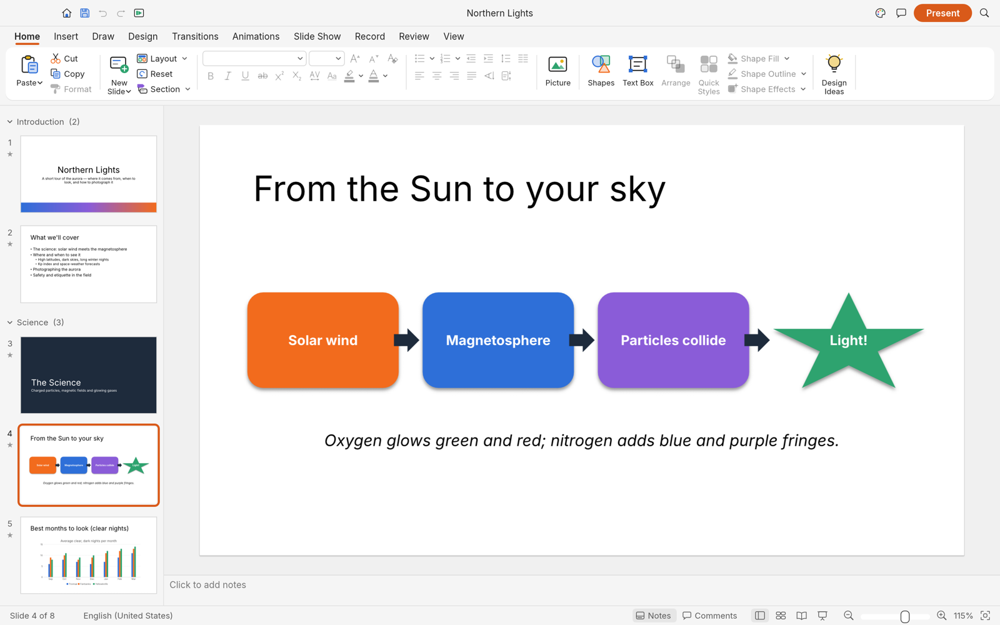
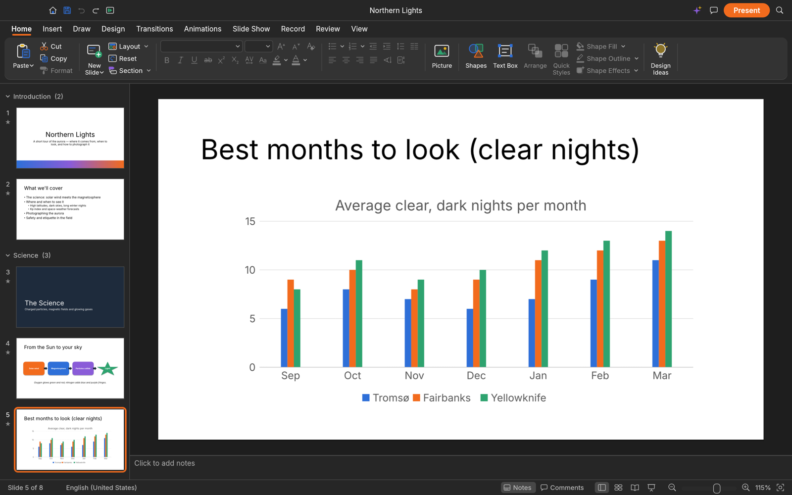

<p align="center">
  <a href="https://malshatti.com/apps/">
    <picture>
      <source media="(prefers-color-scheme: dark)" srcset="docs/brand/warsha-logo-white.svg">
      
    </picture>
  </a>
</p>

<h1 align="center">Minbar</h1>

<p align="center">
  <b>Presentations and slide shows; an open-source, clean-room reimplementation of Microsoft PowerPoint, rebuilt in pure Rust.</b>
</p>

<p align="center">
  Build decks with themes, layouts, shapes, pictures, tables, charts, transitions and animations,
  open and save PowerPoint files, and present them full screen. Native on macOS, Windows, Linux
  and FreeBSD, and in the browser. Every button is also a command that the CLI and AI agents
  (through MCP) can drive.
</p>

<p align="center">
  
  
  
  
</p>

<p align="center">
  <a href="https://discord.gg/warsha"></a>
</p>

<p align="center">
  <a href="https://malshatti.com/apps/minbar.html"><b>Minbar on malshatti.com</b></a> ·
  <a href="https://malshatti.com/apps/">Warsha</a> ·
  <a href="https://malshatti.com/apps/">All Warsha apps</a>
</p>

> [!NOTE]
> **Warsha is a community of artists from all walks of life.** Painters, photographers,
> filmmakers, illustrators, designers, animators, hobbyists, and people who picked up a pencil
> last week. If you make things, you're one of us. **[Come say hi on Discord](https://discord.gg/warsha).**

<p align="center">
  
</p>

<p align="center">
  <a href="#what-works-today">What works</a> ·
  <a href="#getting-started">Getting started</a> ·
  <a href="#agents-cli-and-mcp">Agents, CLI and MCP</a> ·
  <a href="#roadmap">Roadmap</a> ·
  <a href="#downloads">Downloads</a> ·
  <a href="#the-warsha-apps">The Warsha apps</a> ·
  <a href="#license-and-credits">License</a>
</p>

## What works today

Minbar is in alpha, heading for beta (see the [roadmap](ROADMAP.md)).
Today it can:

- **Make decks**: slide masters and eleven layouts with placeholders that inherit position and
  formatting, eight original themes with colour and font schemes, sections, notes, comments,
  headers and footers, custom slide sizes.
- **Draw**: 150+ preset shapes with adjust handles, connectors that stay glued to shapes, freeform,
  curve and scribble tools, merge shapes (union, combine, fragment, intersect, subtract), gradient,
  picture and pattern fills, outlines with dashes and arrowheads, shadows, glow, soft edges and
  reflections.
- **Write**: in-place text editing with full font and paragraph formatting, bullets and numbering,
  columns, autofit, vertical text, fields and hyperlinks.
- **Add content**: pictures with crop and corrections, tables with styles, charts, SmartArt basics,
  audio and video (MP3, AAC, FLAC, ALAC, Ogg, Opus, WAV, AIFF; H.264, HEVC, VP9, AV1).
- **Present**: transitions (including Morph), entrance/emphasis/exit and motion-path animations,
  by-paragraph builds, full-screen slide show, presenter view, pen, rehearse timings, media playback.
- **Exchange files**: open and save PowerPoint `.pptx`, export PDF (slides, notes pages, handouts
  with selectable text), PNG/JPEG and outlines. Unsaved work is kept by AutoRecover.
- **Automate**: 200+ commands with undo, all scriptable from the CLI, a JSON control channel and an
  MCP server for AI agents.

<table>
  <tr>
    <td width="50%"><br><sub>Shape Format contextual tab and selection handles</sub></td>
    <td width="50%"><br><sub>Format Shape pane: gradient type, direction and stops</sub></td>
  </tr>
  <tr>
    <td width="50%"><br><sub>Slide Sorter with each slide's transition</sub></td>
    <td width="50%"><br><sub>Dark mode, with a native chart</sub></td>
  </tr>
</table>

<p align="center">
  <br>
  <sub>The built-in sample deck, rendered by <code>minbar-cli render --sample --all</code></sub>
</p>

## Getting started

```sh
git clone https://github.com/malshatti44/warshaa
cd minbar
cargo run --release -p minbar-cli -- render --sample --all --scale 1 out/
```

On Linux, the build also needs the ALSA headers for slide-show sound: `alsa-lib-devel` on Fedora,
`libasound2-dev` on Debian and Ubuntu, `alsa-lib` on Arch. Without them it stops at `alsa-sys`.

Fonts come from [warsha-fonts](https://github.com/malshatti44/warshaa): clone it next to this repo
(`../warsha-fonts`) and local builds pick it up automatically; without it Minbar uses your system
fonts.

Each [GitHub release](https://github.com/malshatti44/warshaa) has ready-made builds, on Linux as
an AppImage, a `.deb`, an `.rpm` and a tarball. On Gentoo, the community [::snakebyte
overlay](https://github.com/switch87/snakebyte-overlay) packages the Linux release as
`app-office/minbar-bin` (not maintained by the Minbar team):

```sh
eselect repository add snakebyte git https://github.com/switch87/snakebyte-overlay.git
emaint sync -r snakebyte
echo 'app-office/minbar-bin ~amd64' >> /etc/portage/package.accept_keywords/minbar
emerge --ask app-office/minbar-bin
```

### Logs

The desktop app writes its `log` records to standard error and to `logs/minbar.log` in the
settings directory, beside `ui.json` and `prefs.json` (Linux `~/.config/minbar/logs/`, or
`$XDG_CONFIG_HOME/minbar/logs/`; macOS `~/Library/Application Support/Minbar/logs/`; Windows
`%APPDATA%\Minbar\logs\`). A start from a desktop menu or the Dock has no terminal, so this file
is what to attach to a bug report: the crash guard's panic report, a failed crash-recovery save,
PowerPoint parts skipped on import and audio output problems land there. Each launch moves the
previous log to `minbar.1.log` (and that one to `minbar.2.log`), so the log of a run that
crashed survives the next start. The file stops growing at 16 MiB. `--version` writes no file.

| Variable | Effect |
|---|---|
| `RUST_LOG` | Log levels for standard error and the log file. Default: `info` for Minbar's own crates, `warn` for everything else. env_logger-style directives replace that, e.g. `RUST_LOG=debug`, `RUST_LOG=warn,minbar_pptx=trace` or `RUST_LOG=info,wgpu_core=warn`; a directive ending in `*` covers every target starting with it (`minbar*=debug`). |

The logger is `apps/minbar/src/logging.rs`; the realtime audio callback does not log. The web
app logs to the browser console instead.

## Agents, CLI and MCP

Every action in Minbar is a command with a stable id, so people, scripts and AI agents use the
same verbs:

```sh
minbar-cli commands format.          # list commands
minbar-cli run --sample --cmd 'slide.new={"layout":"titleOnly","title":"Hello"}' --save hello.minbar
minbar-cli mcp                       # MCP server over stdio (headless)
minbar-cli mcp --connect 7990        # drive the running app (minbar --control 7990)
```

## Roadmap

Minbar is in **alpha**. It covers **79% of PowerPoint's features by breadth** (92% of the core
ones, measured) and is about **55% of the way to replacing PowerPoint for real work** (estimated).
See [ROADMAP.md](ROADMAP.md) for the stage, numbers by dimension and what's next,
[docs/target-app-parity.md](docs/target-app-parity.md) for the full assessment,
[docs/gaps.md](docs/gaps.md) for every known shortfall and
[docs/parity-checklist.md](docs/parity-checklist.md) for the feature-by-feature checklist.

## Downloads

**Download Minbar** from GitHub: the [latest release](https://github.com/malshatti44/warshaa) has every build listed below, and [all releases](https://github.com/malshatti44/warshaa) has earlier versions and their notes. `<ver>` in the file names is the version number, and `SHA256SUMS.txt` lists a checksum for every file.

### Windows

| Build | Installer | Portable |
|---|---|---|
| x64 (64-bit Intel/AMD) | `minbar-<ver>-windows-x64.msi` | `minbar-<ver>-windows-x64-portable.zip` |
| arm64 (Snapdragon and other ARM PCs) | `minbar-<ver>-windows-arm64.msi` | `minbar-<ver>-windows-arm64-portable.zip` |
| x86 (32-bit) | `minbar-<ver>-windows-x86.msi` | `minbar-<ver>-windows-x86-portable.zip` |

Installers and executables are code-signed.

**If the app doesn't open on Windows:** the desktop app initializes only DirectX 12 by default.
Letting wgpu also create an OpenGL instance can crash some graphics drivers (AMD's
`atio6axx.dll`) before the window appears, so the app would flash in Task Manager and quit.
`WGPU_BACKEND` overrides the default for troubleshooting (for example `dx12` or `vulkan`). In
PowerShell, from the folder containing the executable:

```powershell
$env:WGPU_BACKEND = "vulkan"
& .\minbar.exe
Remove-Item Env:WGPU_BACKEND                     # restore the default for later launches
```

An explicit `gl` override can bring the driver crash back on affected systems. The macOS, Linux
and web backend defaults are unchanged.

### macOS

| Build | File | Notes |
|---|---|---|
| App, universal (Apple silicon + Intel) | `minbar-<ver>-macos-universal.dmg` | Signed and notarized |
| Command-line tool, universal | `minbar-cli-<ver>-macos-universal.zip` | Signed and notarized |

### Linux

| Format | x86_64 | aarch64 (ARM64) | Notes |
|---|---|---|---|
| AppImage | `minbar-<ver>-linux-x86_64.AppImage` | `minbar-<ver>-linux-aarch64.AppImage` | Runs anywhere; updates itself with [AppImageUpdate](https://github.com/AppImageCommunity/AppImageUpdate) (`.zsync` files) |
| Flatpak | `minbar-<ver>-linux-x86_64.flatpak` | `minbar-<ver>-linux-aarch64.flatpak` | Sandboxed; `flatpak install --user <file>` |
| Debian/Ubuntu | `minbar-<ver>-linux-x86_64.deb` | `minbar-<ver>-linux-aarch64.deb` | |
| Fedora/RHEL/openSUSE | `minbar-<ver>-linux-x86_64.rpm` | `minbar-<ver>-linux-aarch64.rpm` | |
| Tarball | `minbar-<ver>-linux-x86_64.tar.gz` | `minbar-<ver>-linux-aarch64.tar.gz` | Unpack anywhere |

RISC-V 64 (riscv64): `minbar-<ver>-linux-riscv64.tar.gz`, a tarball only (cross-compiled; needs glibc 2.39+, e.g. Ubuntu 24.04+).

### FreeBSD

| Build | File |
|---|---|
| x86_64 | `minbar-<ver>-freebsd-x86_64.tar.gz` |

### Web (WebAssembly)

| Build | File | Notes |
|---|---|---|
| Static site | `minbar-web-<ver>.zip` | Runs in a modern browser; host it on any static server |

## The Warsha apps

Minbar is one of the **Warsha apps**: free, open-source creative tools from the
[Warsha](https://malshatti.com/apps/) team, each written from scratch in Rust and each able to
stand on its own.

| | App | What it's for | Code | Learn more |
|:-:|---|---|---|---|
|  | **Retoush** | Image editing: layers, masks, type and real PSD files | [GitHub](https://github.com/malshatti44/warshaa) | [Website](https://malshatti.com/apps/retoush.html) |
|  | **Reesha** | Vector illustration | [GitHub](https://github.com/malshatti44/warshaa) | [Website](https://malshatti.com/apps/reesha.html) |
|  | **Monteer** | Video editing, color and sound | [GitHub](https://github.com/malshatti44/warshaa) | [Website](https://malshatti.com/apps/monteer.html) |
|  | **Tayf** | Photo library and raw development | [GitHub](https://github.com/malshatti44/warshaa) | [Website](https://malshatti.com/apps/tayf.html) |
|  | **Watheeq** | Reading, organizing and protecting PDFs | [GitHub](https://github.com/malshatti44/warshaa) | [Website](https://malshatti.com/apps/watheeq.html) |
|  | **Wamda** | Motion graphics and visual effects | [GitHub](https://github.com/malshatti44/warshaa) | [Website](https://malshatti.com/apps/wamda.html) |
|  | **Nasaq** | Page layout and publishing | [GitHub](https://github.com/malshatti44/warshaa) | [Website](https://malshatti.com/apps/nasaq.html) |
|  | **Minbar** | **Presentations and slide shows · you are here** | [GitHub](https://github.com/malshatti44/warshaa) | [Website](https://malshatti.com/apps/minbar.html) |

And [**Warsha**](https://malshatti.com/apps/) itself, our AI image and video studio for artists who want real control.

<br>

<p align="center">
  <a href="https://discord.gg/warsha"></a>
</p>

<h3 align="center">Come make things with us</h3>

<p align="center">
  Our Discord is where artists of every kind hang out: people who paint, shoot, draw, cut film,
  set type, and people still figuring out what they like to make. Share what you're working on,
  ask for help, tell us what's broken, or tell us what you wish these tools could do.
  Whatever your medium and however long you've been at it, you're welcome here.
</p>

<p align="center">
  <a href="https://discord.gg/warsha"><b>discord.gg/warsha</b></a> ·
  <a href="https://malshatti.com/apps/">malshatti.com</a> ·
  <a href="https://malshatti.com/apps/">The Warsha apps</a> ·
  <a href="https://malshatti.com/apps/minbar.html">Minbar</a>
</p>

## License and credits

Minbar is dual-licensed under [MIT](LICENSE-MIT) or [Apache-2.0](LICENSE-APACHE), at your option.
Copyright (c) 2026 Warsha Team and the Minbar contributors. Required notices are in [NOTICE](NOTICE).

Bundled fonts, icons, images and other assets keep their own open licenses; each one is listed
with its author, source and license in [ATTRIBUTION.md](ATTRIBUTION.md).

Minbar's themes, layouts, shape geometry, icons and sample decks are original work, drawn or
generated in code; no Microsoft artwork, fonts, themes or templates are used.

The Warsha name, wordmark and logos in [`docs/brand/`](docs/brand/) are trademarks of the
Warsha Team and are not covered by this license. They may be used only unmodified, and only as
part of this repository and Minbar, under [`docs/brand/LICENSE-brand.txt`](docs/brand/LICENSE-brand.txt).
Forks and modified versions must remove them.

<sub>Microsoft and PowerPoint are trademarks of the Microsoft group of companies. Adobe, Photoshop, Illustrator, Premiere Pro, Lightroom, Acrobat, After Effects and InDesign are trademarks or registered trademarks of Adobe Inc. in the United States and/or other countries. Minbar is an independent, open-source project and is not affiliated with, sponsored by or endorsed by Microsoft Corporation or Adobe Inc.; these names are used only to describe the workflows it is compatible with.</sub>

<p align="center">
  <a href="https://malshatti.com/apps/"></a><br>
  <sub>Made by the <a href="https://malshatti.com/apps/">Warsha</a> team and community.</sub>
</p>
